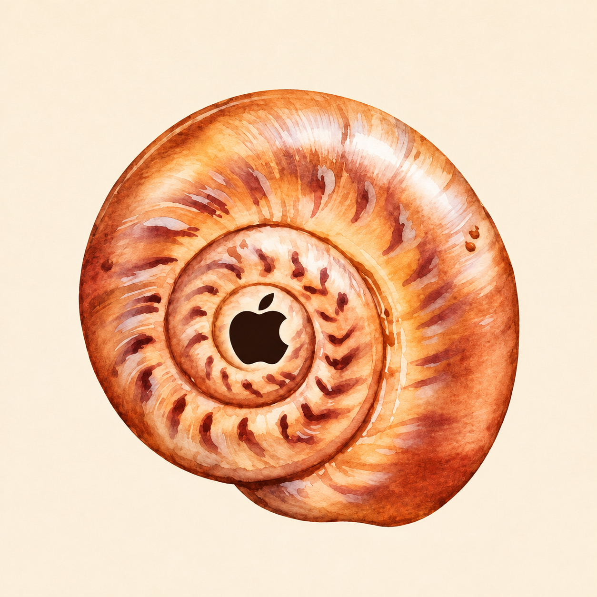

<div align="center">
  

  # macshell

  **A little macOS inspiration for your Windows desktop.**

  An experimental desktop shell built primarily in Rust.

  [](https://github.com/anintas/macshell/releases)
  [](https://www.rust-lang.org/)
  [](https://github.com/anintas/macshell/releases)

  [**Download for Windows**](https://github.com/anintas/macshell/releases/download/v0.1.0-preview/macshell-setup-0.1.0-preview.exe) · [All releases](https://github.com/anintas/macshell/releases) · [Build from source](#build-from-source)
</div>

---

macshell explores a different way to use the Windows desktop. It brings a top bar, Dock, search and system controls into one shell inspired by macOS.

> **Early preview.** Features and window animations are experimental. macshell is an independent project and is not affiliated with Apple.

## What is inside

- **Top bar** — system status and quick controls, always within reach.
- **Dock** — launch and switch between applications.
- **Search** — find apps and actions from one place.
- **Desktop utilities** — widgets and experiments with window management.
- **Glass rendering** — custom visual effects using Windows graphics APIs.

Availability and behavior may vary across Windows configurations.

## Installation

1. Download [macshell setup](https://github.com/anintas/macshell/releases/download/v0.1.0-preview/macshell-setup-0.1.0-preview.exe) for 64-bit Windows.
2. Open the installer and follow the steps. It installs for your Windows account without administrator access.
3. Start **macshell** from the Start menu. A desktop shortcut is optional.

The preview installer is not digitally signed, so Windows may show a SmartScreen warning. To uninstall, use **Settings → Apps → Installed apps → macshell**.

To exit a running copy from a terminal, run `macshell.exe --quit`. If Windows taskbar stays hidden after an unexpected exit, run `macshell.exe --restore-taskbar` from the installation directory.

## Build from source

Requirements: Windows x64, a Rust MSVC toolchain, and Visual Studio C++ build tools.

```powershell
git clone https://github.com/anintas/macshell.git
cd macshell
cargo build --release -p macshell
```

The executable is `target/release/macshell.exe`. Close a running copy before rebuilding: Windows can lock the executable.

To build the installer, install Inno Setup 6 and run:

```powershell
iscc installer\macshell.iss
```

The setup executable appears under `installer/output/`.

## Under the hood

| Component | Role |
| --- | --- |
| `crates/macshell` | Windows integration, shell logic and Slint UI |
| `crates/glass` | Glass rendering and HLSL shader |
| `crates/capture` | Screen capture |
| `crates/macshell/windhawk` | Optional experimental C++ animation integration; upstream attribution is retained in the source |

The application is primarily Rust; the UI uses Slint and the GPU shader uses HLSL. No project-wide license has been specified. Individual third-party components retain their own notices.
